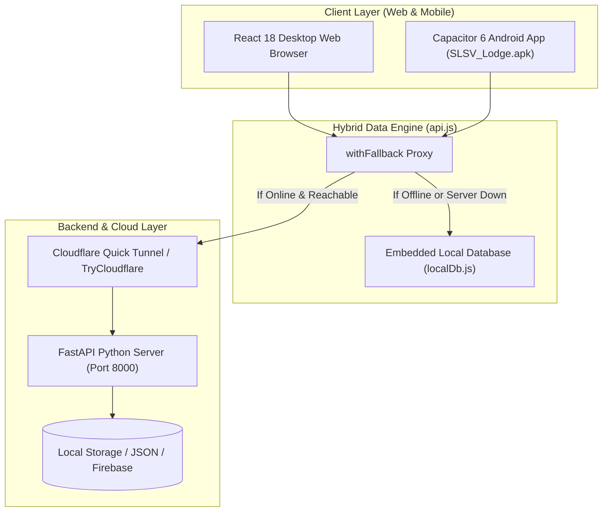

# 🏨 Sri Lakshmi Srungara Vallabha (SLSV) Lodge Management System

[](https://fastapi.tiangolo.com/)
[](https://react.dev/)
[](https://vitejs.dev/)
[](https://capacitorjs.com/)
[](https://opensource.org/licenses/MIT)

A modern, high-performance **Hotel & Lodge Management System** designed for desktop browsers and Android smartphones. Built with **FastAPI**, **React 18**, and **Capacitor 6**, it features an **offline-first hybrid architecture** that runs both locally, in the cloud, or completely standalone on mobile with zero network dependencies.

---

## 📱 Mobile Preview & Android APK

The project compiles directly into a standalone Android APK.
- **Compiled APK**: [`SLSV_Lodge.apk`](SLSV_Lodge.apk) (Root directory)
- **Standalone Engine**: Uses an embedded local database (`localDb.js`) with automatic cloud fallback, allowing the mobile app to function fully even without an active PC server.

---

## 🌟 Key Features

### 1. 📊 Executive Dashboard & Live Room Status Grid
- **Segmented Tabs UI**:
  - **Tab 1: Live Room Status Grid**: Real-time room status tiles (Available, Occupied, Cleaning, Maintenance) with swipeable horizontal filter chips and count badges.
  - **Tab 2: Active Guest Stays**: Responsive stay management with a detailed desktop table and native mobile cards.
- **Key Performance Indicators (KPIs)**: Total Rooms, Available, Occupied, Maintenance, Active Stays, Daily Revenue, and Tax Collected.
- **One-Tap Actions**: Quick Check-In, Status Overrides, and Stay Navigation.

### 2. 🛏️ Comprehensive Room Inventory (`/rooms`)
- Pre-configured with lodge rooms (Standard, Deluxe, Executive, and Suite categories across AC and Non-AC configurations).
- **Smooth Horizontal Filter Pills**: Filter by `All`, `Available`, `Occupied`, `Cleaning`, and `Maintenance` with live count badges.
- **Responsive Search & Filter Bar**: Instant room search and category dropdown with clear buttons.
- **Add / Edit Room Modal**: Configure floor, bed counts, daily tariffs, extra-bed surcharges, and custom amenities (Wi-Fi, TV, Geyser, AC, etc.).

### 3. 📝 Guest Registration & Fast Check-In (`/checkin`)
- Instant room allocation from ready or cleaning rooms.
- Dynamic rate computation based on room category and extra beds.
- Guest KYC data collection (Full Name, Phone, Email, ID Proof: Aadhaar, Passport, Driving License, Voter ID, Address, and Expected Checkout).
- Advance deposit recording and notes.

### 4. 👥 Active Guest Stays & Add-On Room Services (`/active-stays`)
- Active booking overview with guest contact, room badge, and duration.
- **Add-On Charges**: Log extra services (Food, Beverages, Extra Beds, Laundry, Deep Cleaning).
- **Check-Out & Settlement Modal**: Final payment mode selection (Cash, UPI, Card, Net Banking), advance deduction, and instant bill generation.

### 5. 🧾 GST Invoicing & Billing Archive (`/invoices`)
- **Full GST Billing**: Automatic breakdown of subtotal, CGST, SGST, and Grand Total.
- **Dual Responsive Layout**:
  - **Desktop View**: Complete tabular archive with modern action buttons (`View & Print`, `Edit`, `Delete`).
  - **Mobile View**: Dedicated mobile invoice cards with itemized charges, large total callouts, and 44px touch targets.
- **Printable Invoices**: Generates GST-compliant guest receipts formatted for standard A4 desktop printers and 80mm POS thermal roll printers.

### 6. ⚙️ Settings, Dark Mode & System Preferences (`/settings`)
- **Lodge Branding**: Update lodge business name, GSTIN, phone, address, and email.
- **Tax & Tariff Settings**: Configure GST percentages and default check-in/out hours.
- **Theme Switcher**: Animated solar sun and cosmic moon toggle with full dark/light mode support.
- **Cloud API Configuration**: Easily switch between local network, Cloudflare tunnel, or cloud API endpoints.

---

## 🏗️ System Architecture



---

## 💻 Tech Stack

### Frontend & Mobile
- **Core Framework**: React 18.2 with Vite 5
- **Routing**: React Router DOM v6
- **Mobile Runtime**: Capacitor 6 (Android Gradle / Java 17/21)
- **Icons & Styling**: Lucide React, Glassmorphism, CSS Variables, Full Mobile Media Queries
- **State & Offline Storage**: React Context, LocalStorage, Embedded `localDb.js`

### Backend
- **Framework**: FastAPI (Python 3.10+)
- **Server**: Uvicorn (ASGI)
- **Validation**: Pydantic v2
- **Deployment**: Dockerfile, Procfile, and Render / Railway configuration

---

## 🚀 Getting Started

### Prerequisites
- **Node.js**: v18.0.0 or higher ([Download Node.js](https://nodejs.org/))
- **Python**: v3.10 or higher ([Download Python](https://www.python.org/))
- **Android Studio** *(Only needed if recompiling the Android APK)*: Arctic Fox or newer with Android SDK 34 and JDK 17/21.

---

### 1. Quick Start with Batch Scripts (Windows)

The repository includes pre-configured batch scripts in the root directory:

1. **Start Backend Server**:
   ```powershell
   .\start_backend.bat
   ```
   *Runs Uvicorn on `http://0.0.0.0:8000` with interactive Swagger docs at `http://localhost:8000/docs`.*

2. **Start Cloudflare Tunnel (Optional, for remote mobile access)**:
   ```powershell
   .\start_tunnel.bat
   ```
   *Forwards your local backend to a public `https://*.trycloudflare.com` URL.*

---

### 2. Manual Development Setup

#### Backend Setup
```bash
# Navigate to the backend directory
cd backend

# Create and activate a Python virtual environment
python -m venv venv
# On Windows:
venv\Scripts\activate
# On macOS/Linux:
source venv/bin/activate

# Install dependencies
pip install -r requirements.txt

# Run the FastAPI server
python -m uvicorn main:app --host 0.0.0.0 --port 8000 --reload
```
API Documentation will be available at:
- **Swagger UI**: [http://localhost:8000/docs](http://localhost:8000/docs)
- **ReDoc**: [http://localhost:8000/redoc](http://localhost:8000/redoc)

#### Frontend Setup
```bash
# Navigate to the frontend directory
cd frontend

# Install npm dependencies
npm install

# Start the Vite development server
npm run dev -- --host
```
Open your browser at [http://localhost:5173](http://localhost:5173) (or access it over your local Wi-Fi at `http://<your-pc-ip>:5173`).

---

## 📦 Building the Android APK

To recompile the Android debug APK after making changes to the frontend:

```powershell
# 1. Build the frontend web bundle
cd frontend
npm run build

# 2. Sync web assets with Capacitor Android
npx cap sync android

# 3. Compile the Android APK via Gradle
cd android
$env:JAVA_HOME = "C:\Program Files\Android\Android Studio\jbr"
.\gradlew.bat assembleDebug

# 4. Copy the compiled APK to the root directory
Copy-Item "app\build\outputs\apk\debug\app-debug.apk" -Destination "..\..\SLSV_Lodge.apk" -Force
```

---

## 🔑 Default Credentials

The system includes pre-seeded administrator access:
- **Admin Email**: `admin@lodge.com`
- **Password**: `adminpassword123`

---

## 📂 Project Directory Structure

```text
lodge/
├── backend/                         # FastAPI Python Backend
│   ├── data/                        # JSON persistent storage
│   ├── routes/                      # API endpoint route modules
│   ├── config.py                    # Environment and app configuration
│   ├── database.py                  # Database driver & storage models
│   ├── Dockerfile                   # Cloud container build definition
│   ├── main.py                      # FastAPI app entry point
│   ├── models.py                    # Pydantic data schemas
│   ├── Procfile                     # Cloud process file (Render/Railway)
│   ├── render.yaml                  # 1-click cloud deploy configuration
│   └── requirements.txt             # Python package dependencies
│
├── frontend/                        # React + Vite + Capacitor Web & Mobile App
│   ├── android/                     # Native Android project (Gradle/Java)
│   ├── public/                      # Static assets and icons
│   ├── src/
│   │   ├── components/              # Reusable UI components
│   │   │   ├── Navbar.jsx           # Adaptive header & brand title
│   │   │   ├── MobileBottomNav.jsx  # Native mobile bottom tab navigation
│   │   │   ├── RoomCard.jsx         # Modern room status cards
│   │   │   ├── PrintableBill.jsx    # GST & 80mm thermal printable bills
│   │   │   ├── ThemeToggle.jsx      # Animated solar/moon theme switcher
│   │   │   └── ...                  # Modals (Check-In, Room, Service, Invoice)
│   │   ├── context/                 # AuthContext & ThemeContext
│   │   ├── pages/                   # Application views
│   │   │   ├── Dashboard.jsx        # Segmented tabs (Rooms & Stays)
│   │   │   ├── RoomManagement.jsx   # Filter pills, rates, inventory
│   │   │   ├── CheckIn.jsx          # Guest check-in & tariff calculator
│   │   │   ├── ActiveStays.jsx      # Active stays & room services
│   │   │   ├── Invoices.jsx         # Billing archive & mobile cards
│   │   │   └── Settings.jsx         # Lodge info, GST, tariffs & server URL
│   │   ├── services/
│   │   │   ├── api.js               # Dual-engine API client with fallback
│   │   │   └── localDb.js           # Embedded standalone offline database
│   │   ├── App.jsx                  # Main routing & application shell
│   │   └── index.css                # Luxury modern CSS & responsive system
│   ├── capacitor.config.json        # Capacitor Android mobile configuration
│   └── package.json                 # Node.js dependencies & scripts
│
├── SLSV_Lodge.apk                   # Pre-compiled Android Debug APK
├── start_backend.bat                # 1-Click Windows script to launch backend
├── start_tunnel.bat                 # 1-Click Windows script for Cloudflare tunnel
└── README.md                        # Project documentation
```

---

## 📄 License

This project is licensed under the [MIT License](LICENSE).

